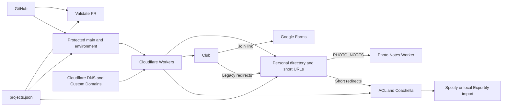

# Architecture

GitHub stores source and reviewed history. Each application packages its own Static Assets and configuration. GitHub Actions validates PRs without Cloudflare credentials. Protected main and a reviewed environment gate control publishing.

The personal Worker assembles directory links at runtime from the bundled registry. Photo Notes stays on the personal origin through a one-way service binding. Club owns BuildFest and retains archived copies while scoped redirects take precedence. Each festival owns its own assets. The personal signup backend is paused and its former POST path returns 503.

See [projects](projects.md), [routing](routing.md), [decisions](decisions/README.md) and [historical migration notes](cloudflare.md).
